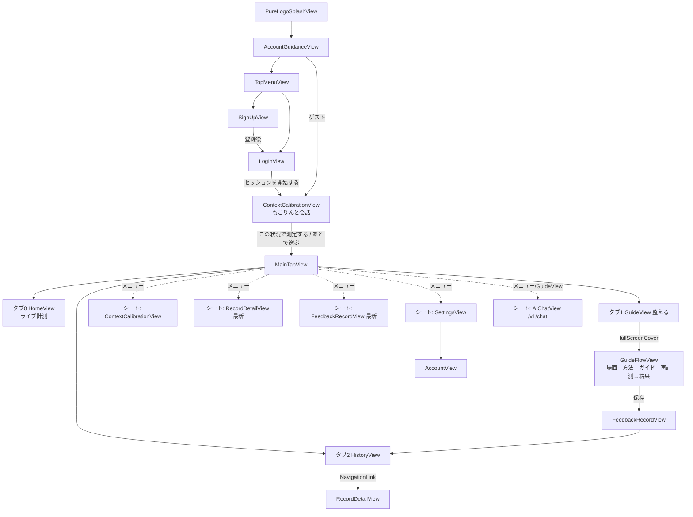
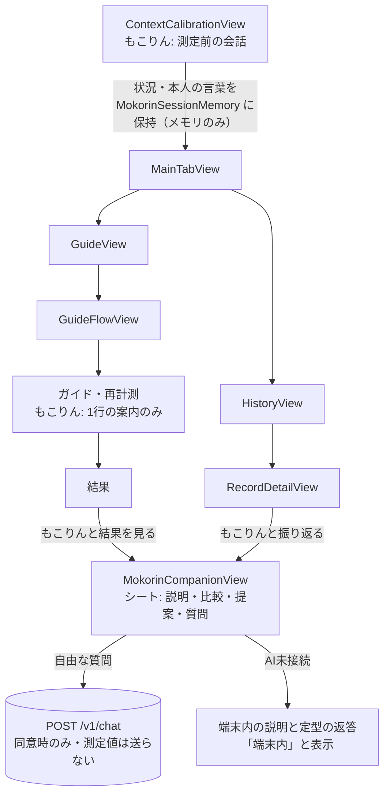

# アプリ全体の画面遷移とデータの流れ（監査）

作成: 2026-11-05 / ブランチ `feature/mokorin-voice-ui-20261028`
対象: `MindWaveGraphic/MindWaveGraphic`（iOS）。根拠はすべてソースコードの該当箇所（パスは `MindWaveGraphic/MindWaveGraphic/` からの相対）。
この文書は既存の `UI_ARCHITECTURE.md` / `CODE_FLOW_GUIDE.md` の画面部分を、現在のコードに合わせて補うもの。

## 1. 現在存在する画面

### 1.1 起動・認証（`App/AppRootView.swift` の `authFlow`、状態は `App/AppFlowState.swift` の `AuthStatus`）

| AuthStatus | 画面（View） | 根拠 |
|---|---|---|
| `.logoSplash` | `PureLogoSplashView` | AppRootView.swift `case .logoSplash` |
| `.accountGuidance` | `AccountGuidanceView`（ゲストは `.contextCalibration`、ログインは `.topMenu`） | 同 `case .accountGuidance`、AccountGuidanceView.swift |
| `.topMenu` | `TopMenuView` | 同 `case .topMenu` |
| `.signUp` | `SignUpView`（登録後は `.logIn` へ） | 同 `case .signUp`、SignUpView.swift |
| `.logIn` | `LogInView`（「セッションを開始する」で `.contextCalibration`） | 同 `case .logIn`、LogInView.swift |
| `.contextCalibration` | `ContextCalibrationView`（もこりんとの会話で測定前の状況を整理） | 同、`Authentication/ContextCalibrationView.swift` |
| `.mainApp` | `MainTabView` | 同 |

### 1.2 メインアプリ（`App/MainTabView.swift`、遷移の情報源は `Navigation/AppNavigationManager.swift`）

| 種類 | 画面 | 入り方 | 根拠 |
|---|---|---|---|
| タブ 0 | `HomeView`（ライブ計測・グラフィック。「計測開始」で `viewModel.toggleLiveMonitoring()`） | 起動直後／下部レバー | MainTabView.swift `TabView`、HomeView.swift `toggleLiveMonitoring` |
| タブ 1 | `GuideView`「整える」（場面を選んでガイドへ） | レバー／メニュー「改善（ワーク）」 | MainTabView.swift、GuideView.swift |
| タブ 2 | `HistoryView`「履歴」（保存したガイドの記録一覧） | レバー／メニュー「過去ログ確認」 | MainTabView.swift |
| 全画面 | `GuideFlowView`（場面 → 方法 → ガイド → 再計測 → 結果） | GuideView の開始ボタン（`fullScreenCover`） | GuideView.swift `fullScreenCover`、GuideFlowView.swift `RegulationFlowStep` |
| プッシュ | `RecordDetailView`（記録の詳細） | HistoryView の行（`NavigationLink`） | HistoryView.swift `NavigationLink(destination: RecordDetailView…)` |
| シート | `ContextCalibrationView`（アプリ内での状況の再設定） | メニュー「対話（状況確認）」 | AppModalDestinationView.swift `.contextCalibration` |
| シート | `RecordDetailView`（最新の記録） | メニュー「結果の確認」 | 同 `.latestRecordConfirmation` |
| シート | `FeedbackRecordView`（最新の記録へのメモ） | メニュー「フィードバック」、GuideFlowView の保存 | 同 `.latestRecordFeedback`、GuideFlowView.swift `showFeedbackView` |
| シート | `NoSessionRecordView`（記録がないとき） | 上の 2 つで記録が 0 件 | AppModalDestinationView.swift |
| シート | `SettingsView` → `AccountView`（シート） | メニュー「設定」 | AppModalDestinationView.swift、SettingsView.swift `showAccountSheet` |
| シート | `AIChatView`（AI 相談・`POST /v1/chat`） | メニュー「AI相談」、GuideView の `AIConsultEntryCard` | AppModalDestinationView.swift `.aiChat`、GuideView.swift |
| シート | `OtherSceneSelectorView` | GuideView の「その他」 | GuideView.swift |
| シート（DEBUG） | `DebugDiagnosticsView`・シミュレーター用の操作 | HomeView の隠し操作 | HomeView.swift `.sheet` |
| 確認ダイアログ | タイトルへ戻る（ログアウト） | メニュー「タイトル」 | MainTabView.swift `confirmationDialog` |

### 1.3 コードはあるが、画面から到達しないもの（存在しても「画面」として数えない）

- `ContentView`（旧構成。どこからも生成されない）
- `GuideSessionView`（旧ラッパー。自身のプレビュー以外から参照なし）
- `Breathing/MindWaveBreathingGuideView`（参照なし）
- `LoginPrototypeView`（`AccountView` からのみ。AccountView は設定から開ける）
- `MokorinGalleryView`（DEBUG の `MW_MOKORIN_GALLERY=1` のときだけ）

## 2. 各画面が使うデータ

| 画面 | 読むデータ | 書くデータ |
|---|---|---|
| ContextCalibrationView | 会話（メモリのみ）、`/v1/context-assist`（同意時） | `AppFlowState.measurementContext`（場面・身体状態） |
| HomeView | `MindWaveViewModel`（Watch の HR、HealthKit の HRV、`StressScoreCalculator` の結果、`lastAnalysisResult`） | ライブ計測の開始・停止 |
| GuideFlowView | 計測スナップショット（`GuideSnapshot`: HR・HRV・スコア・状態・Mock か）、`viewModel.baseline`、`InsightService`（端末内 → 条件を満たせば `/v1/insights`） | `GuideHistoryStore.add(GuideSessionRecord)` |
| HistoryView / RecordDetailView | `GuideHistoryStore.records`（UserDefaults の JSON。`mindwave.guideHistory.v3.json`） | なし（メモの更新は FeedbackRecordView） |
| AIChatView | 会話（メモリのみ）、場面、計測要約（`ChatBiometricPolicy` が許可したときだけ。現在は本物の利用者認証がないため常に送らない） | なし |

## 3. 既存のもこりんの導入箇所（監査開始時点）

- `ContextCalibrationView`（測定前の会話。中央に大きく表示）だけ。
- `MokorinAvatarView`（WKWebView で友達の原本を表示）、`MokorinContextViewModel`（会話の状態）、`MokorinVoiceController`（音声）、`MokorinKeywordInterpreter`（端末内の判定）。
- 結果画面の「AI DEBRIEF」カード（`AIDebriefCard`）と AI 相談（`AIChatView`）は、もこりんとは別の見た目・別の実装。

## 4. もこりんを新たに置ける箇所と価値

| 箇所 | 価値 | 表示方法（UI を増やさない） |
|---|---|---|
| 測定前（既存） | 状況を短い会話で整理 | 中央に大きく（現状維持） |
| ガイド中・再計測中 | 「いつもどおりにしていてね」と計測を妨げない案内 | 1 行の文字だけ。動き・音声なし |
| 結果（GuideFlowView の結果ステップ） | 実際の測定値の説明・不足データ・注意点・状況に合った次の行動 | 「もこりんと結果を見る」1 つ → シートで会話 |
| 記録の詳細（RecordDetailView） | 同じ場面の過去の記録との比較・振り返り | 「もこりんと振り返る」1 つ → 同じシート |
| AI 相談（既存の AIChatView） | 自由な相談 | 既存のまま（同じ `/v1/chat` を共有） |

ホーム（ライブ計測）は計測の邪魔をしないため、もこりんを置かない。

## 5. AI で改善できる体験

1. 測定前: 必要な質問だけで状況を整理し、場面にない予定（試験・初対面など）も自由文で受け止める
2. 結果: 数値を「事実」「解釈（可能性）」「試せること」に分けて説明し、HRV が取れなかったなど不足を正直に伝える
3. 振り返り: 同じ場面の過去の記録（デモデータを除く）とだけ比べ、記録がなければ「まだ比べられない」と伝える
4. 提案: 面接・発表・試験・試合・休憩など状況に合わせた 1〜2 個の行動と、1 回だけの「試してみた？」

## 6. 既存機能との依存関係（変更しないもの）

- HealthKit の HR/HRV 取得、HRV の前処理、`StressScoreCalculator`、`WatchConnectivityManager`、`GuideHistoryStore` の保存形式、JSON 契約の意味は変更しない
- もこりんの説明は `GuideSnapshot`・`GuideSessionRecord` の**既存の値を読むだけ**
- 結果の説明・振り返りは端末内で作る。外部 AI（`/v1/chat`）には利用者が入力した文章と場面だけを送り、測定値は `ChatBiometricPolicy` の条件（同意＋本物の利用者認証）を満たすまで送らない

## 7. 変更後の画面遷移

### 7.1 現在（監査時点）

### 7.2 変更後（もこりんの導線を追加）

